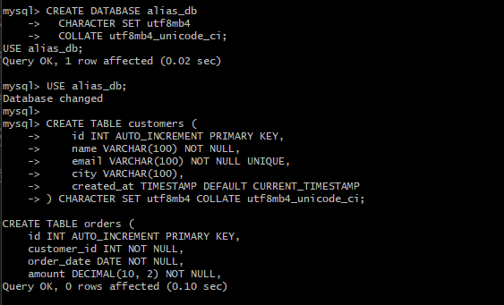
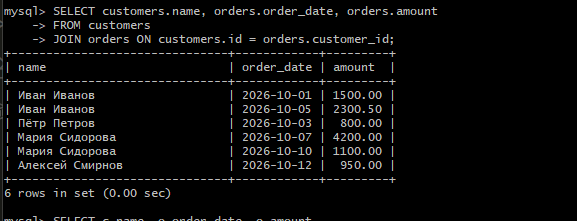
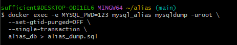

# Отчет по учебному руководству: Алиасы в SQL
## 🔹 1. Подготовка окружения и запуск

В ходе выполнения работы был создан файл конфигурации `my.cnf` и запущен Docker-контейнер с MySQL 8.0.

**Особенность выполнения:** В Git-Bash на Windows при монтировании конфигурационного файла `my.cnf` переменная `general_log_file` не переопределила путь по умолчанию. Лог-файл успешно создается, но MySQL 8.0 по умолчанию пишет его в `/tmp/general.log` внутри контейнера.

*Команда запуска контейнера:*
```bash
docker run --name mysql_alias \
  -e MYSQL_ROOT_PASSWORD=123 \
  -e LANG=C.UTF-8 \
  -e MYSQL_INITDB_SKIP_TZINFO=1 \
  -v mysql_alias_data:/var/lib/mysql \
  -v $(pwd)/my.cnf:/etc/mysql/conf.d/my.cnf \
  -d mysql:8.0


---

## 🔹 2. Создание базы данных и таблиц

База данных `alias_db` была создана с кодировкой `utf8mb4`. Были созданы и заполнены тестовыми данными три таблицы: `customers`, `orders` и `employees`.

---

## 🔹 3. Работа с алиасами (Выполненные запросы)

В ходе работы были отработаны следующие сценарии использования алиасов:

### 3.1. Алиасы таблиц и JOIN
Использование алиасов сделало запрос короче и решило проблему неоднозначности столбцов `id`.
```sql
SELECT c.name, o.order_date, o.amount
FROM customers c
JOIN orders o ON c.id = o.customer_id;
```

### 3.2. Самосоединение (Self Join)
Алиасы `e` и `m` строго обязательны для соединения таблицы `employees` с самой собой.
```sql
SELECT e.name AS employee, m.name AS manager
FROM employees e
JOIN employees m ON e.manager_id = m.id;
```

### 3.3. Алиасы столбцов и агрегация
```sql
SELECT c.name, COUNT(o.id) AS order_count, SUM(o.amount) AS total_amount
FROM customers c
JOIN orders o ON c.id = o.customer_id
GROUP BY c.id, c.name
ORDER BY total_amount DESC;
```
*Примечание: Использование алиаса `total_amount` в `ORDER BY` работает, так как `ORDER BY` выполняется после `SELECT`. Использование его в `WHERE` вызовет ошибку.*

---

## 🔹 4. Ведение и экспорт лога

Поскольку MySQL в контейнере писал лог в `/tmp/general.log`, для извлечения файла на хост использовалась команда:

```bash
docker cp mysql_alias:/tmp/general.log ./general.log
```

**Фильтрация действий:**
Так как при выполнении команд в Git-Bash возникает конфликт конвертации путей (Git-Bash преобразует `/tmp/` в `C:/Users/...`), фильтрация лога выполнялась локально на хосте (в папке с проектом) с помощью `grep`:

```bash
cat general.log \
  | grep -E "Query[[:space:]]+(CREATE|INSERT|SELECT|UPDATE|DELETE|ALTER|DROP|RENAME|DESCRIBE|EXPLAIN|SHOW DATABASES|SHOW TABLES|SHOW FULL TABLES|SHOW CREATE|SHOW VARIABLES LIKE)" \
  | grep -v -E "INSERT INTO help_|INSERT INTO time_zone|INSERT INTO mysql\.|SELECT \* FROM mysql\.general_log" \
  > my_actions.log
```

**Содержимое очищенного лога `my_actions.log`:**
```text
[Вставьте сюда первые 10-15 строк из вашего файла my_actions.log, 
чтобы преподаватель видел, что там только ваши SQL-запросы]
```

---

## 🔹 5. Создание дампа базы данных

Дамп базы `alias_db` был успешно создан и сохранен в файл `alias_dump.sql`.

```bash
docker exec -e MYSQL_PWD=123 mysql_alias mysqldump -uroot \
  --set-gtid-purged=OFF \
  --single-transaction \
  alias_db > alias_dump.sql
```

---

## 📌 Итоги работы

1.  **Алиасы таблиц** (`c`, `o`) значительно сокращают код и обязательны при самосоединении (`e`, `m`) и работе с производными таблицами.
2.  **Алиасы столбцов** (`total_amount`) делают вывод программы понятным. Они доступны в `ORDER BY`, но недоступны в `WHERE` (из-за порядка выполнения запроса).
3.  **Логирование** в Docker-контейнерах MySQL 8.0 может игнорировать пользовательские пути (`/var/lib/mysql/`), сбрасывая логи в `/tmp/`. Извлечение файла на хост через `docker cp` решает эту проблему.
4.  **Git-Bash** на Windows автоматически конвертирует Unix-пути, что ломает команды, передаваемые внутрь контейнера. Для фильтрации логов удобнее использовать локальный файл на хосте.

---

## 📎 Приложения к отчету

В папке с проектом находятся следующие файлы:
*   `my.cnf` — файл конфигурации MySQL.
*   `general.log` — полный лог действий.
*   `my_actions.log` — отфильтрованный лог (только выполненные SQL-запросы).
*   `alias_dump.sql` — дамп базы данных `alias_db`.
```

### Не забудьте:
В разделе **4** в блоке `text` замените текст в квадратных скобках на реальный фрагмент из вашего файла `my_actions.log`.